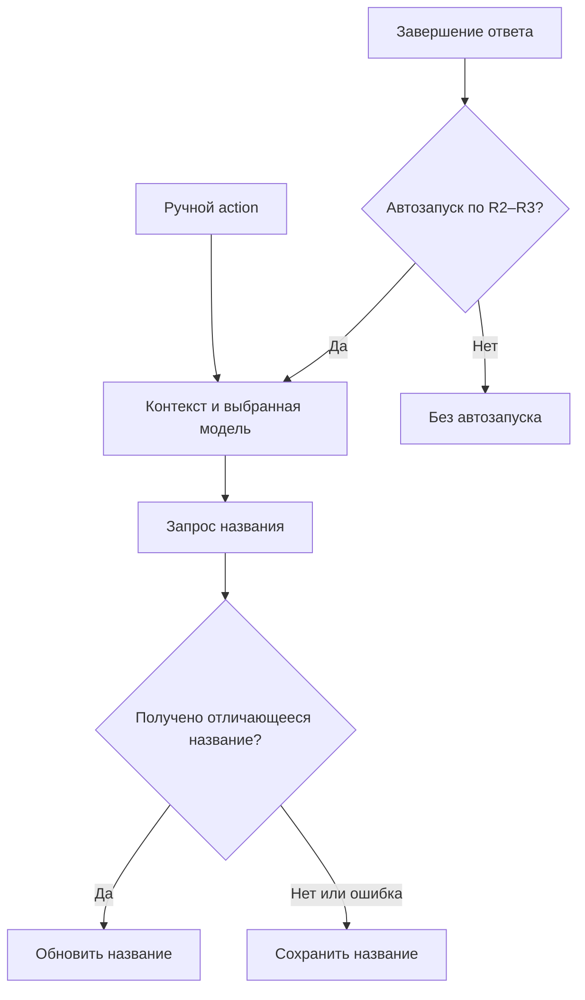
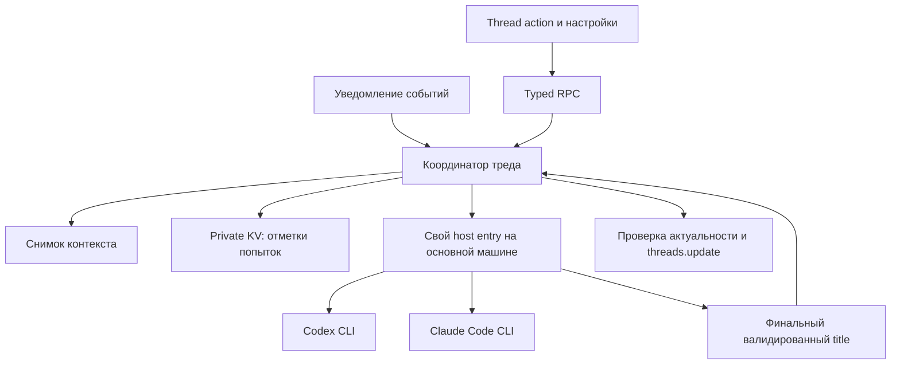
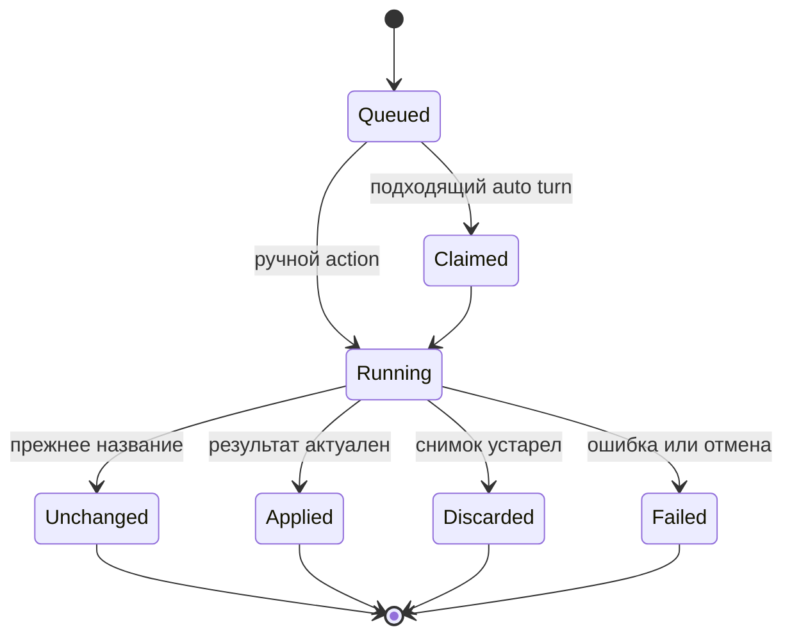
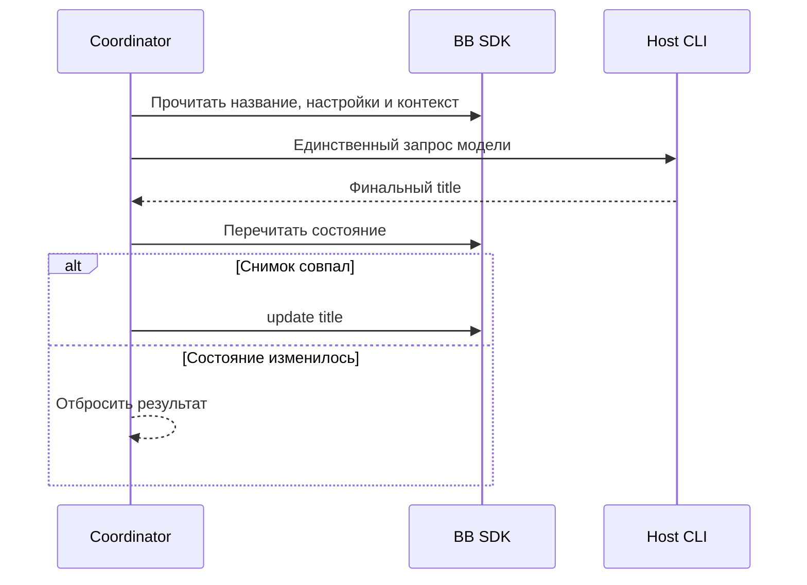

# Обновление названия треда по текущей цели - Plan

## Goal Capsule

**Objective:** Названия тредов помогают пользователю узнавать их текущую цель и связанный с ней тикет.

**Means:** Единый механизм обновления через выбранный CLI на основной машине BB (KTD1–KTD3).

**Product authority:** Product Contract определяет поведение; Planning Contract определяет реализацию в его пределах.

**Execution profile:** Одна поставка плагина; шесть последовательных единиц реализации. Этот документ разрешает планирование; реализация и публикация выполняются после отдельного выбора пользователя.

**Stop conditions:** Не включать адаптер, если проверка его CLI не подтверждает ограничения KTD3; не подменять выбранного провайдера или модель. Проверку завершает исполнитель в U2 и U6.

---

## Product Contract

### Summary

Добавить thread action «Обновить название», который подбирает заголовок по текущей цели разговора. Этот же механизм работает автоматически в начале жизни треда. Провайдер и младшая модель выбираются в настройках плагина для всех тредов.

### Problem Frame

Первоначальное название может перестать описывать цель по мере её уточнения в разговоре. Пользователю нужен узнаваемый заголовок в списке тредов, с привязкой к текущему тикету, когда он известен.

### Key Decisions

- **Момент автозапуска.** Governs R2, R3. (session-settled: user-directed — chosen over запуск при сообщении пользователя или только после первого и пятого ответов: заголовок учитывает завершённый ответ.)
- **Ручное название не закрепляется.** Governs R4. (session-settled: user-directed — chosen over остановка автообновлений после ручного переименования: выбран единый режим первых пяти ходов.)
- **Общий выбор модели в настройках.** Governs R5, R6. (session-settled: user-directed — chosen over автоматический выбор и порядок приоритетов: пользователь выбирает конкретную пару провайдера и модели.)
- **Правила качества и отказа.** Governs R9–R14. (session-settled: user-approved — chosen over свободное перефразирование и изменение при неуспехе: сохраняется подходящее название и основной разговор не засоряется.)

- **Охват первой версии.** Governs R15. (session-settled: user-directed — chosen over все пять доступных агентов и только Codex: выбрана поддержка Codex и Claude Code.)
- **Исторические ходы и сбои.** Governs R16, R17. (session-settled: user-approved — chosen over генерация задним числом и автоматический повтор вызова: исключены неожиданные дополнительные обращения к модели.)

### Requirements

**Запуск**

- R1. В меню действий треда доступен ручной action «Обновить название».
- R2. Для любого треда механизм автоматически вызывается после каждого из первых пяти успешно завершённых ответов агента.
- R3. Начиная с шестого завершённого ответа обновление вызывается только вручную.
- R4. Ручное переименование треда не отключает автозапуски по R2.

**Выбор модели**

- R5. Настройки плагина позволяют выбрать провайдера среди доступных плагинов агентов BB и его младшую модель для генерации названий всех тредов.
- R6. Выбор по R5 не зависит от провайдера конкретного треда.

**Контекст и результат**

- R7. Модель получает текущее название и выборку первых и последних сообщений с сохранением их порядка и ролей.
- R8. Запрос просит подобрать название, отражающее текущую цель треда.
- R9. Заголовок должен быть коротким, конкретным и на языке разговора.
- R10. Если текущее название уже подходит, модель должна вернуть его без перефразирования.
- R11. Когда текущая работа относится к тикету с известным из разговора номером, запрос просит ставить этот номер в начало заголовка; выдумывать номер нельзя.
- R12. Название треда меняется, если полученный заголовок отличается от текущего.

**Фоновая работа и ошибки**

- R13. При ошибке генерации или недоступности выбранной модели текущее название сохраняется, а ручной вызов объясняет причину.
- R14. Генерация выполняется в фоне и не добавляет сообщения в основной разговор треда.

**Уточнения первой версии**

- R15. Первая версия поддерживает Codex и Claude Code; остальные доступные провайдеры отображаются как неподдерживаемые и не выбираются для генерации.
- R16. Порядковые номера ходов считаются за всю жизнь треда; установка плагина не вызывает генерацию для уже завершённых ходов.
- R17. Неуспешный или прерванный автоматический вызов не повторяется автоматически; пользователь может снова вызвать action вручную.

### Key Flows

- F1. **Ручное обновление.** Пользователь вызывает action по R1; механизм собирает контекст по R7, запрашивает название по R8–R11 и применяет результат по R12–R14.
- F2. **Автоматическое обновление.** Завершение ответа запускает тот же механизм по R2–R4 с выбранной парой провайдера и модели по R5–R6.

### Acceptance Examples

- AE1. **Covers R2–R4.** После первого завершённого ответа название обновляется автоматически; после ручного переименования второй ответ также вызывает обновление; шестой ответ его не вызывает.
- AE2. **Covers R1, R3, R6.** После десятого ответа пользователь вызывает action; используется пара из настроек, даже если провайдер треда другой.
- AE3. **Covers R10, R12.** Модель возвращает текущее название; название остаётся прежним.
- AE4. **Covers R11.** При работе над тикетом #123 допустимый результат — «#123 Исправить переключение тредов»; без известного номера модель его не добавляет.
- AE5. **Covers R13–R14.** Выбранная модель недоступна; название сохраняется, ручной вызов сообщает причину, а в основном разговоре не появляется сообщение генератора.

### Scope Boundaries

- Автоматическое переименование после пятого ответа не входит в эту функцию; применяется R3.
- Доработка алгоритма встроенного генератора названий BB не является целью этой работы.

### Scope Boundaries: Deferred to Follow-Up Work

Адаптеры Pi, Cursor и Grok Build отложены согласно R15.

---

## Planning Contract

**Product Contract preservation:** R1–R14, F1–F2 и AE1–AE5 сохранены; добавлены согласованные R15–R17 и связанные Key Decisions, без изменения прежних ID.

### Context and Research

- Текущий проект использует SDK 0.6.79, typed RPC в `repository-contract.ts`, серверную регистрацию в `server.ts`, отдельный host entry в `host.ts` и внедряемую фабрику thread action в `review-action.ts`.
- SDK `PluginHosts.experimental_client` обращается только к host entry своего плагина. `PluginAiServices` регистрирует сервисы, но не предоставляет общий вызов модели другого провайдера; приватный `codex.ai.complete` не является доступным контрактом для этого плагина.
- `experimental_thread.events` объединяет уведомления, а `thread.idle` отражает переход статуса. Источником успешных ходов служат сохранённые события `turn/completed` со статусом `completed`.
- `threads.update` не имеет expected-title/version/CAS. В установленном BB функция `applyGeneratedThreadTitle` применяет первоначальный заголовок только при отсутствии текущего непустого названия.
- Исследованы help и схема Codex CLI 0.164.0; версия Claude CLI на машине не подтверждена. Справка и каталог моделей не доказывают рабочий логин, права на модель или изоляцию запуска.

### Key Technical Decisions

- KTD1. **Свой host entry с двумя адаптерами CLI.** Сервер собирает контекст и применяет результат, host запускает выбранный CLI с его существующим логином. Приватные RPC других плагинов, копирование OAuth-кода и вспомогательные BB-треды не используются. Это продолжает границу `repository-contract.ts` / `host.ts` и исключает создание ходов генератора в BB. Governs R5–R6, R14–R15.

- KTD2. **Общая пара provider/model на основной машине BB.** Хранить непустые ID в `bb.settings`; до явной настройки автоматические обращения пропускаются с объяснением при ручном вызове. Провайдера выбирать отдельным списком с недоступными вариантами по R15, а модель — host `experimental_ProviderModelPicker` с primary-host routing и `allowProviderChange=false`: у picker нет prop фильтра провайдеров. Доступность перепроверять через `providers.list/models` и `hosts.providerCliStatus` на этой же машине; executablePath брать у BB, не из UI. Смена основной машины требует новой проверки. «Младшая» модель выбирается пользователем, без собственной таблицы цен или догадок по имени. Governs R5–R6, R13, R15.

- KTD3. **Ограниченный запуск с сохранением штатной авторизации.** CLI работает в принадлежащем плагину пустом временном каталоге, получает промпт через stdin и выбранную модель аргументом без shell. Не менять HOME/CODEX_HOME, не читать и не копировать токены. Не передавать наследуемые BB_THREAD_ID/BB_PROJECT_ID/BB_ENVIRONMENT_ID и прочие BB-маркеры контекста, чтобы дочерний CLI не управлял основным тредом. Deadline — 60 секунд на запрос, общий предел stdout/stderr — 256 KiB; отмена запроса или поколения плагина завершает только принадлежащее ему дерево процессов и удаляет временные файлы. Подробности провайдеров — в подразделе Provider Invocation. Governs R13–R15.

- KTD4. **Ограниченный снимок разговора.** Передавать первые три и последние шесть непустых сообщений user/assistant без дублей, в хронологическом порядке, с текущим названием и пометкой границы пропуска. Каждое сообщение ограничить 2 000 Unicode-символами, сохраняя начало и конец с явной отметкой усечения; полный контекст ограничить 24 000 символами. Последние сообщения имеют приоритет при определении текущей цели и актуального тикета. Историю брать из проекции timeline/message, сохраняя historySnapshot и source sequence; не трактовать ID элемента outline как seq. Полные тела инструментов, reasoning и вложений не передавать. При изменении historySnapshot во время чтения заново собрать контекст до начала единственного вызова модели. Governs R7–R11.

- KTD5. **Один валидируемый результат.** Промпт отделяет инструкции генератора от сообщений как данных и просит JSON с единственным title. Для Codex использовать output schema, для Claude — structured output/JSON result. Принимать только финальный успешный ответ, убрать внешние пробелы и схлопнуть внутренние; пустой, многострочный служебный, несоответствующий схеме или длиннее 120 Unicode-символов результат считать ошибкой. Детерминированно не добавлять номер из случайного упоминания: запрос просит префикс только для тикета текущей цели по R11. Если модель вернула текущее название, не вызывать update. Governs R8–R13.

- KTD6. **Сверка событий и постоянная отметка попытки.** Слушать `experimental_thread.events`, затем постранично читать типизированные `turn/completed` и определять первые пять уникальных успешных turnId за всю жизнь треда. Хранить в private `bb.storage.kv` версию записи и до пяти отмеченных turnId на тред. Перед вызовом модели записать отметку попытки; после неё автоматический повтор исключён даже при краше. На каждом запуске плагина зафиксировать границу времени активации и не генерировать для завершений раньше этой границы: история учитывается, пропущенные во время выключения ходы не воспроизводятся. Сначала установить listener и буфер, затем сверять события; batch уведомлений не должен терять отдельные завершения. KV достаточно при единственном серверном владельце и очереди KTD7; распределённый exactly-once не заявляется. Governs R2–R4, R16–R17.

- KTD7. **Очередь на тред и проверка актуальности перед записью.** Ручные и автоматические операции идут через один серверный координатор; повторный одновременный ручной клик разделяет текущую ручную операцию, отдельные подходящие автоматические ходы не объединяются. Перед каждым вызовом снять контекст, настройки и текущее название; перед update перечитать их. При изменении настроек, контекста или названия отбросить устаревший результат с понятным исходом, без нового платного запроса. Изменённое вручную название при следующем обычном автозапуске остаётся допустимым входом по R4. Разные треды имеют независимые очереди; общий host исполняет не более двух генераций одновременно. Это защищает от собственных устаревших записей; окно между внешним изменением и update остаётся, потому что публичного CAS нет. Governs R1–R4, R12–R14, R17.

- KTD8. **Один backend action для UI и автоматизации.** Собственный typed RPC возвращает один из исходов updated, unchanged, skipped, failed, без текста исходного промпта и полного stderr. Thread action и автоматический обработчик вызывают этот же сервис. RPC доступен обычным клиентам BB; отдельный агентный инструмент и отдельная CLI-команда не требуются. Через `bb plugin rpc` агент может вызвать ту же операцию после регистрации discoverable RPC. Governs R1, R13–R14.

### Provider Invocation

**Codex.** Использовать noninteractive `exec` с `--ignore-user-config`, `--ignore-rules`, `--ephemeral`, `--skip-git-repo-check`, read-only sandbox, моделью, stdin и JSON/output schema. Штатный auth остаётся у CLI. Документированные отдельные controls: `features.shell_tool=false`, `features.apps=false`, `features.multi_agent=false`, `features.hooks=false`, `features.memories=false`, `features.remote_plugin=false`, `web_search="disabled"`, `tools.view_image=false`. Проверить их поддержку установленной версией, используя strict config; неизвестные параметры не игнорировать. Нет подтверждённого общего allowlist/`toolChoice:none` в исследованной схеме. Пустой cwd и read-only sandbox сами по себе не доказывают отсутствие инструментов. До включения адаптера U2/U6 должны подтвердить совокупное ограничение, в том числе при managed policy; иначе вернуть R13, не запускать обычного агента как запасной путь.

**Claude Code.** Использовать обычный print mode со штатным логином, заданной моделью, JSON schema/result, `--tools ""`, запретом MCP, strict пустым MCP config, исключением источников project/user settings и no-session-persistence. Отключить чтение CLAUDE.md, auto-memory, slash commands, IDE/Chrome, вложенную генерацию названия и hooks документированными средствами установленной версии. `--bare` не подходит: этот режим не использует subscription/OAuth login. Как и у Codex, несовместимые flags или обязательная политика завершают попытку по R13; настройки пользователя не меняются.

### High-Level Technical Design

**Компоненты и поток данных — KTD1–KTD5, KTD8.**

**Жизненный цикл операции — KTD6–KTD7.**

Для автоматических операций отметка Claimed остаётся после всех терминальных исходов по R17. Ручной запрос не изменяет бюджет пяти автоматических ходов.

**Протокол записи и граница гонки — KTD7.**

Внешняя запись между последними двумя обращениями к BB не блокируется. Строгая атомарность потребовала бы изменения SDK/core и не входит в этот плагин.

### Risks and Dependencies

- Изоляция CLI, логин и доступ к выбранной модели проверяются на основной машине; каталог и документация не считаются успешным smoke. Это обязательное условие включения соответствующего адаптера, а не открытая продуктовая развилка.
- Один выбранный провайдер может временно не работать; запасной провайдер не выбирается молча, применяется R13.
- Номер тикета может отсутствовать в ограниченной выборке или быть неоднозначным; запрос не должен выдумывать префикс по R11. Вне контекста ничего дополнительно не читается.
- Вызовы на разных тредах разделяют лимит KTD7. Ожидание очереди отменяется при выключении плагина; уже отмеченные автоматические операции не воспроизводятся по R17.
- Строгая внешняя атомарность рассмотрена и не строится: title обратим, SDK не имеет CAS, а R4 допускает автоматическое изменение ручного названия.
- Автоматические ретраи, распределённые leases, отдельная таблица моделей/цен и хранение полных промптов рассмотрены и не строятся: выбранные R13/R17 и однопроцессный владелец не требуют их.

### Deferred to Implementation

- Подтвердить конкретную совместимую версию Claude CLI и managed-policy поведение обоих адаптеров; неподтверждённый адаптер не объявлять готовым.
- Уточнить расположение модулей по текущему плоскому стилю репозитория; смысл границ U1–U6 сохраняется.
- Проверить поведение отмены и очистки дерева CLI на ОС машины BB; не полагаться только на завершение родительского PID.

### Sources and References

- `review-action.ts`, `review-action.test.ts`, `server.ts`, `host.ts`, `repository-contract.ts`: действующие фабрика, RPC и host boundary.
- `node_modules/@get-bb/plugin-sdk/bundled-types/bb-plugin-sdk.d.ts`: `PluginSettings`, `PluginStorage`, `PluginThreadEventPayloads`, `ThreadsArea`, `HostsArea`, `PluginHosts`.
- `node_modules/@get-bb/plugin-sdk/bundled-types/bb-plugin-sdk-app.d.ts`: `experimental_ProviderModelPicker`, `settingsSection`, `useSettings`.
- Установленный BB `server/dist/start-server.js`, `applyGeneratedThreadTitle`: первоначальная генерация не заменяет непустой заголовок; это привязано к исследованной установленной версии.
- [Codex CLI reference](https://developers.openai.com/codex/cli/reference/) и [Codex configuration reference](https://developers.openai.com/codex/config-reference/): управление запуском и отдельными возможностями; применять с проверкой версии, а не предполагать полный запрет инструментов.
- [Claude CLI reference](https://code.claude.com/docs/en/cli-reference), [headless mode](https://code.claude.com/docs/en/headless), [environment variables](https://code.claude.com/docs/en/env-vars): print mode, настройки и ограничение `--bare`.

---

## Implementation Units

### U1. Contracts and Provider Settings

**Goal:** Определить общий контракт генерации и выбор поддерживаемой модели.

**Requirements:** R5–R6, R13, R15; KTD1–KTD3, KTD8.

**Dependencies:** Нет.

**Files:** новые `title-contract.ts`, `title-configuration.ts`, `title-contract.test.ts`, `title-configuration.test.ts`; изменения `server.ts`.

**Approach:** Разделить внешний RPC и host contract по образцу `repository-contract.ts`. Настройки providerId/model без секретов валидируются сервером, возвращают состояние configured/unconfigured/unavailable и сохраняются через `bb.settings`. Проверку primary host и CLI каталога держать в этом слое, не в UI.

**Patterns to follow:** `repository-contract.ts`, typed RPC в `server.ts`; публичные settings API SDK.

**Test scenarios:**

1. Пара Codex/model сохраняется и перечитывается после пересоздания сервиса.
2. Claude выбирается для треда Codex, не наследуя модель треда. Covers AE2.
3. Пустая настройка, выключенный провайдер, отсутствующая primary machine или CLI дают определённый отказ, не исполняя команду. Covers AE5.
4. Pi и произвольный providerId не принимаются как поддерживаемый выбор.
5. Изменение настроек порождает новую ревизию для KTD7.

**Verification:** Контракты отличают отсутствие конфигурации от недоступности; интерфейс не может передать свой executable или host для произвольного выполнения.

### U2. Isolated CLI Adapters

**Goal:** Получать ограниченный финальный ответ через два CLI на машине исполнения.

**Requirements:** R5–R6, R13–R15; KTD1–KTD3, KTD5; Provider Invocation.

**Dependencies:** U1.

**Files:** новые `title-provider.ts`, `title-provider.test.ts`, `title-provider-host.test.ts`; изменения `host.ts`, `title-contract.ts`.

**Approach:** Разместить provider-specific argv и разбор JSON в двух явных ветках без нового adapter framework. Собственный host handler принимает проверенные параметры и использует поддерживаемый stdin-spawn, а не portable helper с null stdin. Сначала подтвердить capability contract установленных версий без вызова модели; затем выполнять только ограниченный путь KTD3.

**Execution note:** Сначала зафиксировать argv, границы конфигурации и отмену контрактными тестами; реальный inference проверяется в U6.

**Patterns to follow:** `host.ts` — argument-array execution, AbortSignal и ограниченный вывод; SDK host worker lifecycle.

**Test scenarios:**

1. Оба адаптера передают выбранную модель и промпт через stdin без shell, не включая содержимое промпта в аргументы.
2. Промпт с кавычками, shell-синтаксисом и инструкцией прочитать файл остаётся данными.
3. Codex использует явные controls, schema и ephemeral state; Claude удаляет built-ins/MCP и не использует `--bare`.
4. Неподдерживаемые параметры/версия, ненулевой exit, malformed JSON и превышение вывода завершаются отказом. Covers AE5.
5. Deadline, клиентская отмена и reload завершают принадлежащее плагину дерево процессов и очищают файлы.
6. Переменные BB-контекста не наследуются, но штатный auth location остаётся доступным CLI без чтения токенов плагином.

**Verification:** Host harness доказывает routing, prompt transport, ограничение процесса и output parsing; фиктивный ответ не объявляется доказательством реальной изоляции.

### U3. Conversation Snapshot and Title Prompt

**Goal:** Сформировать контекст текущей цели и проверить возвращённый заголовок.

**Requirements:** R7–R12; KTD4–KTD5.

**Dependencies:** U1.

**Files:** новые `title-context.ts`, `title-context.test.ts`.

**Approach:** Использовать timeline/message с source sequence и historySnapshot, прочитать нужные разговорные сообщения и применить выборку KTD4. Хранить только выбранные данные на время операции. Промпт и нормализация результата принадлежат этому модулю; model invocation остаётся в U2.

**Patterns to follow:** SDK timeline/message DTO; чистые преобразования с прямыми тестами, как в `repository-link.ts`.

**Test scenarios:**

1. Короткая история попадает в контекст без дублей; длинная выбирает именно начало и конец в исходном порядке.
2. Tool/reasoning/attachment bodies исключаются; лимиты и отметки пропуска сохраняются.
3. Пагинация/редактирование сообщений не смешивают разные historySnapshot; ID outline не используется как seq.
4. Новая цель из последних сообщений важнее старого тикета; текущий #123 даёт инструкцию префикса, отсутствующий номер не выдумывается. Covers AE4.
5. Подходящее текущее название сохраняется в инструкции; возвращённое прежнее название означает unchanged. Covers AE3.
6. Пустой разговор и некорректный результат отказывают без title mutation.

**Verification:** Детерминированные fixtures доказывают состав контекста и контракт результата; семантика текущего тикета дополнительно проверяется реальным smoke U6.

### U4. Refresh Coordinator and Automatic Turn Tracking

**Goal:** Объединить запуск, историю попыток и безопасное применение результата.

**Requirements:** R1–R4, R12–R14, R16–R17; F1–F2; KTD6–KTD8.

**Dependencies:** U1–U3.

**Files:** новые `title-refresh.ts`, `title-refresh.test.ts`, `title-state.ts`, `title-state.test.ts`; изменения `server.ts`.

**Approach:** Единственный координатор владеет listener, очередями и KV. На уведомлении сверяет сохранённые события согласно KTD6, перед запуском фиксирует попытку, затем собирает снимок и применяет KTD7. Ручной RPC не создаёт автоматическую отметку. Ошибки одного треда не блокируют другие.

**Patterns to follow:** action factory injection из `review-action.ts`, но состояние переносится на backend; SDK `storage.kv` и disposer lifecycle.

**Test scenarios:**

1. Успешные ходы 1–5 вызывают генерацию, шестой — нет; failed/interrupted и idle без хода не считаются. Covers AE1.
2. Batch из нескольких завершений и повтор уведомления сохраняют каждую подходящую попытку ровно один раз в обычной работе.
3. Старый тред с пятью ответами не вызывает обращения после установки; тред с двумя ответами получает автообновление на будущем третьем.
4. Сохранённая отметка до вызова переживает пересоздание сервиса; прерванная попытка не переотправляется автоматически.
5. Ручное переименование не выключает будущие автозапуски. Covers AE1.
6. Ручной клик после десятого ответа работает; одинаковые одновременные клики не удваивают запрос. Covers AE2.
7. Смена title/settings/context во время генерации отбрасывает старый результат; разные треды не смешивают ответы.
8. Unchanged не вызывает update; error/timeout не меняет title и сообщает причину ручному caller. Covers AE3, AE5.
9. Выключение плагина снимает listener, отменяет операции и не запускает накопившуюся очередь заново.

**Verification:** Integration harness проводит событие/ручной RPC через coordinator, host stub и SDK update; отдельный тест воспроизводит сохранённый state после reload.

### U5. Thread Action and Settings UI

**Goal:** Сделать общий механизм доступным в действиях треда и настройках плагина.

**Requirements:** R1, R5–R6, R13, R15; F1; KTD2, KTD8.

**Dependencies:** U4.

**Files:** новые `title-action.ts`, `title-action.test.ts`, `title-settings.tsx`, `title-settings-view.test.tsx`; изменения `app.tsx`, `server.ts`.

**Approach:** Зарегистрировать action по примеру текущего review action без spawn/navigation. Настройки используют отдельный список провайдеров, штатный model picker без переключения провайдера и RPC U1 согласно KTD2. Показывать ошибку/недоступность в UI, сохраняя R14. Сделать refresh RPC discoverable для уже имеющегося `bb plugin rpc`, без отдельной агентной регистрации.

**Patterns to follow:** `app.tsx` threadAction slot, `review-action.test.ts` для run/error поведения; SDK settings section и штатный picker.

**Test scenarios:**

1. Action отправляет ID выбранного треда и отражает busy/error без перехода в другой тред.
2. Provider/model загружаются из общих настроек, а не из треда. Covers AE2.
3. Неподдерживаемый провайдер виден с причиной и не сохраняется; пустой каталог сохраняет видимость прежней настройки.
4. RPC и UI вызывают тот же coordinator и получают одинаковые исходы.
5. Ошибка появляется вне основного разговора. Covers AE5.

**Verification:** UI и RPC используют один backend action; action доступен в обычном thread menu и Customize actions по штатному slot.

### U6. Integration Evidence and Documentation

**Goal:** Подтвердить реальную работу каждого адаптера и описать эксплуатационные границы.

**Requirements:** R1–R17; AE1–AE5; KTD1–KTD8.

**Dependencies:** U5.

**Files:** новый `title-refresh.integration.test.ts`; изменения `README.md`, `package.json` только при необходимости engine/description, `package-lock.json` только при изменении зависимостей.

**Approach:** Зафиксировать полный путь manual/auto через fake SDK/host, затем на одноразовых тредах выполнить live smoke обоих CLI с выбранными пользователем младшими моделями. Зафиксировать версии, model IDs, исходы и отсутствие побочных действий без хранения промптов или секретов в репозитории. Документация объясняет настройку, primary-host routing, first-five semantics и ограничения R15–R17.

**Test scenarios:**

1. Полный сценарий AE1–AE5 проходит на integration harness, включая рестарт и недоступность выбранного провайдера.
2. Каждый реальный адаптер отвечает заголовком по текущей цели, сохраняет подходящий заголовок и использует актуальный номер тикета.
3. Враждебный текст с просьбой выполнить команду/прочитать sentinel не вызывает инструменты, чтение sentinel, MCP или hooks.
4. Существующий логин работает без API ключа; отсутствующий/истёкший логин даёт R13 без интерактивного зависания.
5. В основном разговоре нет сообщений генератора, вспомогательные BB-треды не созданы.

**Verification:** При отсутствии доступа к одному CLI его smoke отмечается непроведённым; вся поддержка двух адаптеров не объявляется завершённой. Не заменять отсутствующее доказательство mock-тестом.

---

## Verification Contract

| Проверка | Применимость | Единицы | Успешный исход |
|---|---|---|---|
| `npm run typecheck` | Весь diff | U1–U6 | Публичные SDK contracts и React props корректны |
| `npm test` | Весь diff | U1–U6 | Новые сценарии и существующие функции проходят |
| `bb plugin build` | Готовая сборка | U1–U6 | Server, host и frontend bundle собираются |
| Backend/host integration harness | События, отмена, routing | U2, U4–U6 | Вызовы и сохранение результата соответствуют KTD1–KTD8 |
| Live smoke Codex и Claude Code | Каждый поддерживаемый адаптер | U2, U6 | Штатный логин, выбранная модель и ограничения подтверждены фактически |
| Live BB action/settings check | Установленный плагин | U5–U6 | Выбор модели и обновление треда работают без загрязнения разговора |

Проверки выполняются при реализации, не при составлении этого плана. Новые сценарии проверяют поведение, а не буквальное повторение внутренних helpers. Для низкорисковых правок README отдельные тесты не нужны.

---

## Definition of Done

- R1–R17 покрыты реализацией и указанными проверками; AE1–AE5 имеют успешное подтверждение.
- U1–U6 имеют указанные наблюдаемые результаты, обе выбранные модели реально вызываются через CLI, а изоляция KTD3 подтверждена.
- Настройки и отметки попыток переживают штатный reload; первые пять ходов считаются корректно без задних и повторных обращений.
- Существующие repository link, review action, sidebar labels и thread switcher сохраняют поведение после общей проверки.
- Остаточные ограничения внешней гонки и поддерживаемых CLI описаны в README; неподдерживаемые адаптеры не выданы за работающие.
- Удалены временные probe-файлы, заброшенные варианты, фоновые процессы и фиктивные production обходы; в diff нет секретов или сохранённых исходных разговоров.
